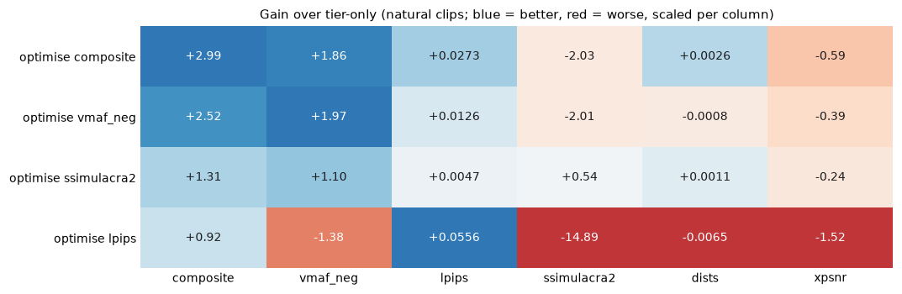
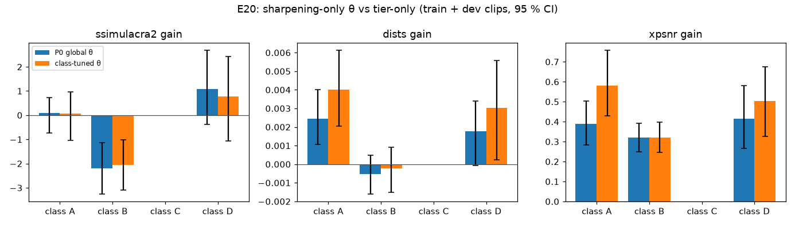
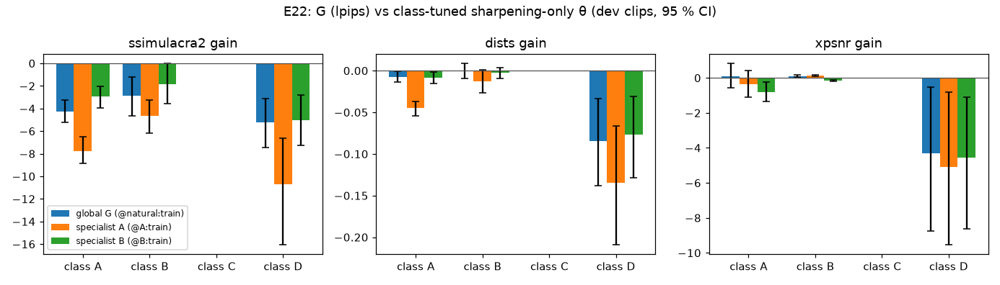
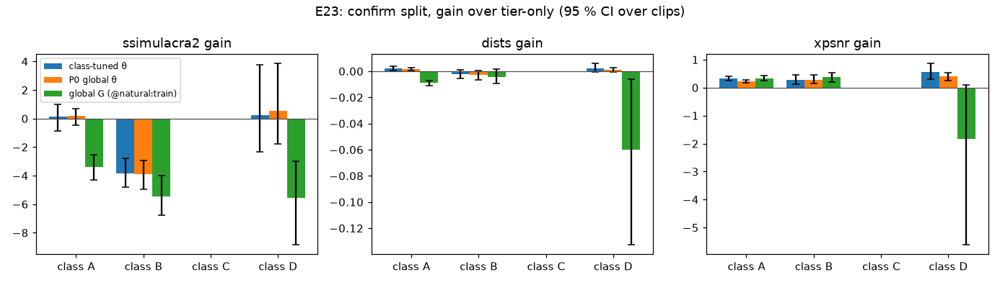

# Progress

Status as of 2026-10. The direction is in [`idea.md`](idea.md). The prior-work and license notes
are in [`docs/related-work.md`](docs/related-work.md). The full result tables are in the
[README](README.md#results-simulated-platforms-3-s-720p-clips-rtx-4060--6-cores).

## 1. What has been done

| Area | State | Where |
|---|---|---|
| Clip set: 3 synthetic clips + 4 Xiph natural clips, 3 s, 720p | done | `vreg clips`, `src/vreg/content.py` |
| Simulated black-box platforms `ugc_strict` and `ugc_av1`: ladder chosen by upload resolution, ingest denoise, capped CRF, fixed 720p rendition | done | `src/vreg/platform.py` |
| Real-platform adapter `CommandPlatform` (user-supplied upload and download commands, polling) | implemented, **not yet run on a real platform** | `src/vreg/platform.py` |
| Parametric pre-compensation θ (7-D): denoise, contrast, saturation, upscale/tier, unsharp amount and radius, temporal grain | done | `src/vreg/precomp.py` |
| Metrics: VMAF NEG, LPIPS, CAMBI, PSNR, SSIM; objective `composite = VMAF_NEG − 40·LPIPS − 2·CAMBI` | done | `src/vreg/metrics.py` |
| Black-box search: GP-BO, TPE, CMA-ES, random (Optuna, resumable, cached evaluations) | done | `vreg optimize` |
| Transfer to unseen clips, and the naive → tier-only → full decomposition | done | `vreg transfer` |
| Learned `G` through a differentiable emulator `E`, with a trust region and real-platform validation rounds | done | `vreg surrogate`, `src/vreg/surrogate/` |
| HTML report: convergence, sensitivity, crops, transfer table, surrogate rounds; mean ± sd across seeds | done | `vreg report` |
| Report-only judges SSIMULACRA2, DISTS, XPSNR (not in `composite`), back-filled from cached playbacks; frozen knobs (`--fix`) | done (P0) | `vreg rescore`, `vreg optimize --fix`, `src/vreg/metrics.py` |
| P0 experiments E1–E5 | done | [§6](#6-p0-results), `scripts/run_p0.sh`, `scripts/p0_tables.py` |
| P1: content-scoped learned `G`, gate, pre-registered classes (E19–E23), 77-clip licensed set | done: H1 not confirmed, gate accepted | [§7](#7-p1-results), `docs/p1/`, `scripts/run_p1.sh`, `scripts/p1_tables.py` |
| Unit tests on tiny clips, CI without torch | done | `tests/`, `.github/workflows/ci.yml` |
| Prior-work and license review | done | `docs/related-work.md` |

## 2. What the current results show

> **Revised by the P0 results ([§6](#6-p0-results)).** Points 1, 3 and 6 below are the pre-P0
> claims. P0 replaced point 1: GP-BO > TPE > random over five seeds. It did not confirm point 3:
> SSIMULACRA2 and XPSNR are lower than tier-only on every natural clip, on every seed. It
> downgraded point 6: `G` beats tier-only on 3/4 natural clips and beats θ only on
> old_town_cross. Point 2, the tier gain, is confirmed by every independent metric.
>
> **P1 ([§7](#7-p1-results))** settles point 6 on 77 clips with pre-registered classes: the learned
> `G` does not beat a class-tuned sharpening-only θ on any class, and it damages graphics and
> animation. Point 4 is refined: mild sharpening alone does not hurt graphics; the content gate
> that is accepted is "sharpen natural low-motion content, tier-only elsewhere".

All numbers are from **simulated** platforms, with **one seed** per configuration and 3-second
clips. They show that the method and the tooling work. They are not yet evidence about real
platforms.

1. **The closed loop works and all samplers improve on a naive upload.** On `sim:ugc_strict`,
   `composite` rose from 29.45 to about 43–44 within 40 trials. GP-BO scored 43.80 and random
   search 42.90. With one seed, **the samplers cannot be told apart.** The space is small and
   dominated by one discrete choice, so random search is a strong baseline.
2. **About 80 % of the gain is the tier trick.** Uploading at ×2 (1440p) gets a better codec and
   more bits. This trick is common creator knowledge (see `docs/related-work.md`), and the
   simulator contains it by construction. It is a sanity check, not a finding.
3. **Filtering adds a further +2 to +4 on natural footage, and it transfers to unseen natural
   clips** (ducks_take_off +3.4, in_to_tree +3.7 over tier-only).
4. **The same θ damages graphics and text** (testsrc −11.6 compared with tier-only). Pre-
   compensation has to be **content-adaptive**. This matches the published bad-case rate for
   deep pre-processors on UGC (up to 26 % in Tri-Dynamic Preprocessing).
5. **Different platform, different optimum.** On `sim:ugc_av1` the best θ uses no grain and
   stronger sharpening, whereas on `ugc_strict` it uses grain. The loop has to run against the
   actual target platform.
6. **The learned `G` exploits the emulator unless it is constrained.** Without a trust region,
   real quality collapsed (old_town_cross 60.4 → 39.0). With a trust region, round 0 beat
   tier-only on every natural clip, including the held-out in_to_tree (+4.0), and beat GP-BO θ on
   smoother content. Later domain-adaptation rounds **did not help**.

### What the results do **not** yet show

* That any of this transfers to a real platform.
* That the colour, contrast and sharpening gains are perceptual improvements and not metric
  hacking. P0 checked them with three independent metrics, which did not confirm them. A viewer
  study is still missing.

## 3. Open problems

* **The objective and the independent judges disagree on the filter gain** (P0, §6). No single
  metric optimised so far is free of regressions on the others, and there is no viewer study
  to decide which side is right.
* **The learned `G` does not beat simple sharpening on any content class** (P1, §7). It raises
  LPIPS, its training loss, and lowers SSIMULACRA2 and DISTS. Whether a better-constrained `G`
  (the P1-later items E7–E9) can do better is open.
* **Class C (natural, flat or dark) is untested:** the licensed natural sources gave one such
  clip. Own recordings could be added as a separate exploratory addendum.
* **Domain-adaptation rounds degrade.** `E`'s fidelity on `G`'s outputs stays at about 25 dB on
  dense texture, and `G`'s residual keeps growing.
* **The simulator lacks some real behaviours:**
  * passthrough or "no second encode" below a bitrate cap, which Bilibili users report (community
    claims, not verified);
  * several renditions served to different viewers;
  * AV1 film-grain synthesis;
  * a delayed or popularity-dependent switch to AV1 or VP9;
  * non-deterministic re-encodes.
* **No LICENSE file** in the repository yet (see `docs/related-work.md`).

## 4. Experiment backlog

Each item names the question it answers, what is compared, and what counts as success.
**P0** items should be done before any claim is made; **P1** items extend the method; **P2** items
are larger studies.

### P0: make the existing claims solid

Execution plan (code changes, commands, decision rules): [`docs/P0-plan.md`](docs/P0-plan.md).
**All five are done.** The results and verdicts are in [§6](#6-p0-results).

| # | Experiment | Compare | Success criterion |
|---|---|---|---|
| E1 | ✅ **Seeds and variance**: 3–5 seeds per sampler on `ugc_strict`, and 3 seeds for `vreg surrogate` | GP-BO vs TPE vs CMA-ES vs random; learned `G` vs GP-BO θ | Mean ± spread reported. A sampler or method "wins" only if the gap is larger than the spread |
| E2 | ✅ **Independent metrics**: add SSIMULACRA2 (BSD) and DISTS (piq, Apache-2.0), plus ffmpeg XPSNR. Re-score the existing best θ and `G` without re-optimising | naive / tier-only / best θ / `G`, on objective metrics vs unoptimised metrics | The filter gain over tier-only keeps the same sign on SSIMULACRA2 and DISTS |
| E3 | ✅ **Metric-hacking ablation**: re-run GP-BO with the contrast and saturation (`eq`) knobs frozen at 0 | full θ vs θ without `eq` | Tells how much of the +2–4 filter gain is colour or contrast (suspect) and how much is grain or sharpening |
| E4 | ✅ **Goodhart matrix**: optimise for VMAF NEG only, for composite, and for SSIMULACRA2; evaluate each result with all metrics | 3 objectives × all metrics | The objective whose optimum still scores well on the other metrics becomes the default |
| E5 | ✅ **Filter-only at the native tier**: search θ with the upscale fixed at ×1 | filter gain at ×1 vs filter gain at ×2 | Separates the filter gain from the tier gain more cleanly than the transfer table |

### P1: content-scoped learned pre-compensation

Execution plan: [`docs/P1-plan.md`](docs/P1-plan.md). P0 confirmed only the tier gain. P1 tests
whether a learned `G` beats the strongest surviving filter, a class-tuned sharpening-only θ, for
a content class defined **before** training. It also adds a gate that switches filters off
elsewhere. Classes, hypotheses, splits and decision rules are pre-registered, and the confirm
split is evaluated once. **All five are done.** The results and verdicts are in [§7](#7-p1-results).

| # | Experiment | Compare | Success criterion |
|---|---|---|---|
| E19 | ✅ **Content set and classes**: about 60 licensed 3 s clips; SI/TI, flat and dark fractions; classes A (natural, low motion, moderate detail), B (dense texture or high motion), C (flat, gradient or dark), D (graphics, text, screen, animation); train/dev/confirm splits grouped by source | none (set-up) | ≥ 12 clips in A and B, ≥ 8 in C and D; `docs/p1/` committed before any training |
| E20 | ✅ **Baselines per class**: naive, tier-only, P0 global sharpening-only θ, class-tuned sharpening-only θ | per class, all metrics | Fixes the baseline `G` must beat |
| E21 | ✅ **`G` loss selection**: LPIPS vs DISTS vs LPIPS+DISTS (a `G` is never judged by its own loss) | on class A dev | One loss fixed for E22–E23 |
| E22 | ✅ **Specialist vs global `G`**, 3 seeds | global `G`, specialist A, specialist B vs class-tuned sharpening-only θ, on dev | Choose the `G` and the gate table before E23 |
| E23 | ✅ **Gate and confirmation** (once, on the confirm split) | gated system vs tier-only vs global sharpening-only θ | H1: ≥ 2 judges with a 95 % CI over clips excluding 0, SSIMULACRA2 not worse, sign holds in ≥ 2/3 seeds. Gate: no class worse than tier-only on SSIMULACRA2 or XPSNR |

E6 (content-adaptive θ) is absorbed into E19–E23: the gate is its content-adaptive part.

### P1-later: method improvements

These items waited on P1. P1 found that the current `G` does not beat class-tuned sharpening on
any content class ([§7](#7-p1-results)), so they are now the only route by which a learned `G` could
earn its place. Success should be judged against the P1 gate, not against tier-only.

| # | Experiment | Compare | Success criterion |
|---|---|---|---|
| E7 | **Real-forward / surrogate-backward estimator** for `G`: `y = y_real + E(x) − stopgrad(E(x))`, following SelfC and SCALED | current `G` (emulator forward) vs this estimator | No collapse without a trust region; the gain on dense texture (park_joy, ducks) moves closer to GP-BO θ |
| E8 | **Emulator robustness**: an ensemble of `E` with a disagreement penalty; a conservative (COMs-style) `E`; `G`-like perturbations in round-0 data; temporal context (stacked frames) | trust region only vs each option | Emulator PSNR on `G`'s outputs above 30 dB, and domain-adaptation rounds improve instead of degrading |
| E9 | **Hybrid**: BO for tier, grain and colour, then `G` for local detail on top of the chosen θ | θ alone vs `G` alone vs hybrid | Hybrid ≥ the best of the two on every natural clip |
| E10 | **Trust-region BO** (BoTorch TuRBO tutorial, MIT) and BO warm-started from simulator results | GP-BO vs TuRBO vs warm-started BO, at budgets of 10, 20 and 40 trials | Reaches 90 % of the 40-trial gain within about 15 trials (this sets the real-platform budget) |
| E11 | **Common creator recipe as a baseline**: lanczos ×2 + mild unsharp, at a fixed upload bitrate | creator recipe vs best θ | Shows what the optimiser adds over standard advice |

### P1: simulator realism

| # | Experiment | Compare | Success criterion |
|---|---|---|---|
| E12 | Add a **passthrough branch below a bitrate cap** (Bilibili-style "no second encode"); make upload bitrate part of θ | old vs new profile; does the optimiser find the passthrough region? | The optimiser discovers the bitrate threshold when it exists |
| E13 | Add **AV1 film-grain synthesis** (denoise + grain table) to `ugc_av1`, and **several renditions** (480p/720p/1080p, weighted) | single 720p rendition vs multi-rendition objective | θ that is robust across renditions |
| E14 | **Cross-platform transfer**: apply the `ugc_strict` θ to `ugc_av1` and the reverse | transferred vs native θ | Quantifies how much tuning per platform matters |

### P2: real platform and human study

| # | Experiment | Compare | Success criterion |
|---|---|---|---|
| E15 | **Platform probe** (no optimisation). Upload a resolution × bitrate grid of your own test clip (private or unlisted, rate-limited). Record the codecs and bitrates served (`yt-dlp -F`), and re-upload the same file to measure non-determinism | upload resolution and bitrate vs served codec and bitrate | A measured ladder, which then sets the simulator profile |
| E16 | **Real closed loop** through `CommandPlatform` with a budget of about 15–20 uploads, warm-started from simulation | naive vs tier-only vs creator recipe vs found θ | A filter gain over tier-only on unoptimised metrics, on a real platform |
| E17 | **Subjective check**: paired comparison (2AFC) between tier-only and best θ or `G`, with 5–10 viewers, on held-out clips | preference rate | Preference above 50 % with a confidence interval that excludes 50 % |
| E18 | **Longer and more varied content**: 10–30 s clips; UGC, animation, screen recordings, dark scenes with banding risk | per content class | Per-class gain table; tells where pre-compensation should be switched off |

## 5. Engineering backlog

* Add a `LICENSE` file (MIT or Apache-2.0 fit the current dependencies).
* Record upload size and bitrate as a cost in every evaluation.
* A `CommandPlatform` example script for one platform, with rate limiting and private uploads
  (E15, E16).

## 6. P0 results

Plan: [`docs/P0-plan.md`](docs/P0-plan.md). Everything below is on the **simulated** platforms. The
tables are generated by `scripts/p0_tables.py` from each run's `rescore.json` (`vreg rescore`).
**All gains are signed so that positive means better**, including LPIPS and DISTS, where lower is
better. "Natural clips" are park_joy and old_town_cross (training), plus ducks_take_off and
in_to_tree (unseen). The per-clip signs are listed in that order.

Judges: SSIMULACRA2 (py-ssimulacra2, mean over every 3rd frame), DISTS (piq, GPU, every 3rd
frame) and luma XPSNR (ffmpeg `xpsnr` filter). None of them is part of `composite`.

### E2: independent metrics on the existing results

Mean gain over tier-only on the natural clips (per-clip signs in brackets):

| configuration | composite | vmaf_neg | lpips | ssimulacra2 | dists | xpsnr | verdict |
|---|---|---|---|---|---|---|---|
| GP-BO θ, ugc_strict (`strict_gp`) | +3.03 (+ + + +) | +1.87 (+ + + +) | +0.0280 (+ + + +) | −2.23 (− − − −) | +0.0003 (+ − − +) | −0.75 (− − − −) | **not confirmed** (1/3) |
| GP-BO θ, ugc_av1 (`av1_gp`) | +4.94 (+ + + +) | +3.13 (+ + − +) | +0.0437 (+ + + +) | +1.90 (+ − − −) | +0.0071 (+ + − +) | +0.21 (+ − − −) | stands (3/3), but carried by park_joy |
| learned G round 0 (`surrogate_trust`) | +2.55 (+ + + +) | −1.03 (− + − −) | +0.0832 (+ + + +) | −5.17 (− − − −) | +0.0101 (− + + +) | +1.24 (+ + + +) | stands (2/3), SSIMULACRA2 disagrees on every clip |
| *reference: tier gain (tier-only − naive), ugc_strict* | +12.27 (+ + + +) | +9.50 (+ + + +) | +0.0657 (+ + + +) | +23.02 (+ + + +) | +0.0267 (+ + + +) | +1.54 (+ + + +) | stands (3/3) |

* **The tier gain is real.** Every judge agrees on every natural clip.
* **The `ugc_strict` filter gain over tier-only is not confirmed.** The full θ (+6 % contrast,
  +15 % saturation, unsharp, grain 6) raises the objective and its components on every natural
  clip. It lowers SSIMULACRA2 and XPSNR on every natural clip, and DISTS is flat. This is the
  pattern expected from metric hacking.
* `ugc_av1` passes the rule on the means, but only because of park_joy. There, the AV1 tier-only
  upload is *worse* than naive on SSIMULACRA2 (−49.9 vs −29.4), and θ recovers +14.3 of that. On
  the other three natural clips, SSIMULACRA2 and XPSNR are slightly lower with θ than with
  tier-only.
* The learned `G` passes on XPSNR (4/4 clips) and DISTS (3/4). SSIMULACRA2 is lower on every clip
  (mean −5.2), and VMAF NEG is lower on 3/4. Later rounds are worse on SSIMULACRA2 (sky_gradient
  −13 → −26).
* testsrc, `ugc_strict` θ vs tier-only: composite −11.6, but SSIMULACRA2 +1.3, DISTS −0.004 and
  XPSNR −7.0. The large composite loss there is mostly CAMBI reacting to the added grain.

### E3: contrast and saturation frozen (`strict_gp_noeq`, `--fix contrast=1,saturation=1`)

Best θ: ×2, unsharp 0.89 (5×5), **no grain**, no denoise. Mean gain over tier-only on the natural
clips:

| metric | full θ (`strict_gp`) | `eq` frozen | ratio |
|---|---|---|---|
| composite | +3.03 | +2.18 | 72 % |
| vmaf_neg | +1.87 | +1.03 | 55 % |
| lpips | +0.0280 | +0.0277 | 99 % |
| ssimulacra2 | −2.23 | −1.74 | (full gain ≤ 0) |
| dists | +0.0003 | +0.0035 | (full gain ≈ 0) |
| xpsnr | −0.75 | +0.52 | (full gain ≤ 0) |

* With `eq` frozen, the optimiser also drops the grain. The result keeps 72 % of the composite
  gain, 55 % of the VMAF NEG gain and all of the LPIPS gain, and it **passes the E2 rule (2/3:
  DISTS and XPSNR)**. SSIMULACRA2 is still lower than tier-only.
* So the colour/contrast boost and the grain it brings along account for about 30 % of the
  composite gain and 45 % of the VMAF NEG gain. They are also what turns XPSNR and DISTS negative.
  This is the suspect part. The plain sharpening part survives two of three judges.

### E5: native tier, filter-only (`strict_gp_native`, `--fix upscale=1`)

Best θ: ×1, **+11 % contrast**, −1 % saturation, grain 3.2, no sharpening. The filter gain at ×1
(best − naive) vs at ×2 (`strict_gp`, best − tier-only), mean over the natural clips:

| metric | ×2 (`strict_gp`) | ×1 (`strict_gp_native`) |
|---|---|---|
| composite | +3.03 | +3.02 |
| vmaf_neg | +1.87 | +2.49 |
| lpips | +0.0280 | +0.0095 |
| ssimulacra2 | −2.23 | −2.48 |
| dists | +0.0003 | −0.0023 |
| xpsnr | −0.75 | −2.13 |

* At the native tier the composite gain is as large as at ×2. It comes almost entirely from
  contrast, and **no judge agrees (0/3)**. At ×1 the filter gain is metric hacking: VMAF NEG
  rewards the contrast boost.

### E4: Goodhart matrix

Rows: optimised objective (GP-BO, 40 trials). Cells: gain of the best θ over tier-only, mean over
the natural clips. Bold cells were optimised by that row (composite contains VMAF NEG and LPIPS).

| objective | composite | vmaf_neg | lpips | ssimulacra2 | dists | xpsnr | negative non-own cells | mean rank |
|---|---|---|---|---|---|---|---|---|
| composite | **+2.99** | **+1.86** | **+0.0273** | −2.03 | +0.0026 | −0.59 | ssimulacra2, xpsnr | 2.00 |
| vmaf_neg | +2.52 | **+1.97** | +0.0126 | −2.01 | −0.0008 | −0.39 | ssimulacra2, dists, xpsnr | 2.17 |
| ssimulacra2 | +1.31 | +1.10 | +0.0047 | **+0.54** | +0.0011 | −0.24 | xpsnr | 2.33 |
| lpips | +0.92 | −1.38 | **+0.0556** | −14.89 | −0.0065 | −1.52 | vmaf_neg, ssimulacra2, dists, xpsnr | 3.50 |

Best θ per row: composite ×2, contrast 1.06, saturation 1.11, unsharp 0.49, grain 9.1;
vmaf_neg ×2, contrast 1.05, saturation 0.94, unsharp 0.62, grain 15; ssimulacra2 ×2, contrast
1.02, saturation 1.04, no unsharp, grain 3.8; lpips ×2, contrast 1.11, saturation 1.25, unsharp
1.68, grain 14.1.

testsrc, same cells: composite row +0.53 / ssimulacra2 +2.12 / xpsnr −6.99; ssimulacra2 row
composite −10.30 / ssimulacra2 −2.37 / xpsnr −4.31; lpips row xpsnr −11.80.

* **No objective satisfies the decision rule.** Every row lowers at least one judge it did not
  optimise. `ssimulacra2` comes closest, with one small negative (XPSNR −0.24), but its gain on
  its own metric is small (+0.54). `composite` has the best mean rank, but that rank is helped by
  the three columns it optimises.
* **Default objective: `composite` is kept**, because the rule gave no winner, and the CLI default
  is unchanged. A filter gain found with any of these objectives must be checked with the judges
  (`vreg rescore`) before it is reported.
* **Optimising LPIPS alone is a textbook Goodhart case.** It maxes out saturation, sharpening and
  grain, and it is the worst row on every other judge (SSIMULACRA2 −14.9).
* Re-running `strict_gp` with the same seed (`strict_gp_obj_composite`) did not replay it bit for
  bit: best 43.72 vs 43.80, with a similar recipe. Optuna's GP sampler is not deterministic, so
  run-to-run noise exists even at a fixed seed.

### E1: seeds and variance

Samplers on `ugc_strict`, composite, 40 trials, two training clips. Five seeds: seed 0 is the
original run (`strict_<sampler>`), seeds 1–4 are `strict_<sampler>_s<n>`.

| sampler | seeds | final best (mean ± sd) | trial reaching 95 % of final gain (mean ± sd) |
|---|---|---|---|
| GP-BO | 5 | **43.79 ± 0.02** | 17.4 ± 8.0 |
| TPE | 5 | 43.43 ± 0.35 | 16.2 ± 5.5 |
| CMA-ES | 5 | 40.71 ± 3.82 | 22.4 ± 6.6 |
| random | 5 | 42.82 ± 0.51 | 15.6 ± 10.3 |

By the rule (A beats B only if mean(A) − mean(B) > max(sd(A), sd(B))): **GP-BO beats TPE (+0.36)
and random (+0.96), and TPE beats random (+0.61).** No sampler beats CMA-ES or loses to it by the
rule, because its sd is so large.

* **GP-BO is the best and by far the most consistent sampler** (sd 0.02 over five seeds). The
  earlier claim "with one seed, the samplers cannot be told apart" is replaced by this ranking:
  GP-BO > TPE > random.
* **CMA-ES is unreliable at this budget.** On two of five seeds (`s2`, `s3`) it never left the
  ×1.5 tier and ended at about 36.5. `upscale` is a continuous knob snapped to {1, 1.5, 2}, and
  CMA-ES starts in the middle of the box with a small step size. With a population of 8, 40
  trials are only five generations, too few to cross into the ×2 tier on some seeds.
* **The best θ is not identifiable, even though the objective is.** The five GP-BO runs reach
  43.77–43.80, but their recipes differ:
  * grain ranges from 0 to 15;
  * unsharp ranges from 0.42 (5×5) to 1.23 (3×3);
  * saturation sits at the upper bound of 1.25 in four of five runs.

  All runs agree on ×2 and +4–6 % contrast. The objective is flat along grain and sharpening,
  so the earlier "all samplers converge on the same recipe" (grain ≈ 6–7, unsharp 0.4–0.8) was
  one point on a ridge, not a stable optimum.

**E2 across seeds.** The four extra GP-BO seeds were re-scored on every clip (`vreg rescore
runs/strict_gp_s<n>`):

| GP-BO seed | composite | ssimulacra2 | dists | xpsnr | verdict |
|---|---|---|---|---|---|
| 0 (`strict_gp`) | +3.03 | −2.23 (− − − −) | +0.0003 | −0.75 | not confirmed (1/3) |
| 1 | +3.22 | −3.97 (− − − −) | −0.0017 | −0.55 | not confirmed (0/3) |
| 2 | +3.19 | −2.88 (− − − −) | −0.0017 | −0.30 | not confirmed (0/3) |
| 3 | +2.98 | −2.64 (− − − −) | −0.0006 | −0.01 | not confirmed (0/3) |
| 4 | +3.08 | −2.70 (− − − −) | −0.0015 | −0.35 | not confirmed (0/3) |

The filter gain over tier-only fails the rule on **every seed**. SSIMULACRA2 is lower than
tier-only on every natural clip in every seed. Seed 0 was the most favourable run for the claim,
not the least.

**Learned `G` across seeds.** `vreg surrogate --rounds 1` with seeds 0, 1 and 2
(`surrogate_trust_s<n>`), the same settings as `surrogate_trust`. Every seed passes the E2 rule
2/3 (DISTS and XPSNR). SSIMULACRA2 is lower than tier-only on every natural clip in every seed
(mean −5.2 to −6.9).

Real composite and SSIMULACRA2 per clip, mean ± sd over seeds (`G`: 3 seeds, round 0; GP-BO θ:
5 seeds):

| clip | tier-only | GP-BO θ composite | `G` composite | GP-BO θ ssimulacra2 | `G` ssimulacra2 |
|---|---|---|---|---|---|
| park_joy *(train)* | 22.21 | **24.95 ± 0.17** | 22.75 ± 0.21 | **−23.57 ± 0.94** | −27.11 ± 0.46 |
| old_town_cross *(train)* | 60.40 | 62.62 ± 0.16 | **65.39 ± 0.87** | 51.48 ± 0.78 | 50.87 ± 0.96 |
| ducks_take_off *(train for `G`)* | 25.97 | **29.09 ± 0.27** | 25.45 ± 0.38 | **−23.29 ± 1.10** | −26.99 ± 0.98 |
| in_to_tree *(held out)* | 58.28 | 62.59 ± 0.40 | 62.32 ± 0.81 | **42.73 ± 0.66** | 38.31 ± 1.54 |
| sky_gradient *(held out)* | 93.07 | **92.87 ± 0.29** | 82.99 ± 1.56 | **86.18 ± 0.95** | 66.91 ± 4.47 |

Bold: the winner by the pairwise rule; no bold means a tie.

* **`G` beats GP-BO θ only on old_town_cross, and only on the objective** (+2.8). On SSIMULACRA2
  the two tie there.
* On the held-out in_to_tree, `G` and θ tie on composite, and θ wins on SSIMULACRA2. The earlier
  claim "`G` beats θ on smoother content (old_town_cross, in_to_tree)" holds only for
  old_town_cross.
* **`G` does not beat tier-only on every natural clip.** On ducks_take_off it is below tier-only
  in all three new seeds (25.45 ± 0.38 vs 25.97), although ducks is one of its training clips.
* `G` damages the held-out synthetic gradient much more than θ does (composite −10.1 vs
  tier-only, SSIMULACRA2 −24).

### Verdicts

| # | Claim | Verdict |
|---|---|---|
| E2 | Tier gain over naive (ugc_strict) | **stands**: all three judges, all natural clips |
| E2 | Filter gain over tier-only, ugc_strict GP-BO θ (+2–4) | **not confirmed**: SSIMULACRA2 and XPSNR lower on every natural clip |
| E2 | Filter gain over tier-only, ugc_av1 GP-BO θ | stands by the rule, but carried by one clip (park_joy) |
| E2 | Learned `G` (trust region) beats tier-only | stands by the rule (DISTS, XPSNR); SSIMULACRA2 disagrees on every clip |
| E3 | Part of the filter gain is colour/contrast hacking | **confirmed**: freezing `eq` costs 28 % of the composite gain and makes the result pass 2/3 judges |
| E5 | Filters help on their own, without the tier | **not confirmed**: at ×1 the gain is contrast only, 0/3 judges |
| E4 | `composite` is a safe default objective | **not confirmed**: no objective is free of judge regressions; default kept, results must be re-scored |
| E1 | Samplers cannot be told apart | **replaced**: over 5 seeds, GP-BO > TPE > random by the rule; CMA-ES misses the ×2 tier on 2/5 seeds |
| E1 | All samplers converge on the same recipe | **downgraded**: tier (×2) and contrast (+4–6 %) are stable; grain (0–15) and sharpening vary freely at the same score |
| E1 + E2 | Filter gain over tier-only, ugc_strict, across seeds | **not confirmed** on all 5 GP-BO seeds (0–1/3 judges); SSIMULACRA2 lower on every clip in every seed |
| E1 | Learned `G` beats tier-only on all natural clips | **downgraded**: 3/4 clips; below tier-only on ducks_take_off in all 3 new seeds |
| E1 | Learned `G` beats GP-BO θ on smoother content | **downgraded**: only old_town_cross, only on composite; tie on in_to_tree, where θ wins on SSIMULACRA2 |

## 7. P1 results

Plan: [`docs/P1-plan.md`](docs/P1-plan.md). Platform `sim:ugc_strict`, upload ×2. Driver:
`scripts/run_p1.sh`; tables, CIs and decision rules: `scripts/p1_tables.py` (→ `runs/p1_tables.md`).

### E19: content set, classes and splits (frozen before any training)

The manifest, features and classes (`docs/p1/clips.csv`, `features.csv`, `classes.json`) were
committed before E20. The set has **77 three-second segments from 47 sources**, with a license
recorded for every row:

* **53 natural** segments, all from media.xiph.org:
  * SVT MultiFormat (the four P0 clips plus crowd_run);
  * SVT 720p and TUM 1080p (no copyright, no restrictions);
  * NTIA/ITS (research use only);
  * public-domain video-conference sequences.
* **14 animation**: Blender open movies (CC BY), plus the HDgreetings sequences (benchmarking and
  research only). The HDgreetings sequences turned out to be 3-D rendered e-cards, so they were
  labelled `animation` rather than `natural` before any feature was computed.
* **4 screen**: this repository's own files rendered as scrolling editor, terminal and document
  views (`scripts/make_screen_clips.py`). They are rendered, not captured.
* **6 synthetic**: the three P0 lavfi clips plus a text ticker on colour bars, Game of Life and a
  dark gradient.

Not used: YouTube-UGC (no official license wording found) and Netflix Open Content (CC BY-NC-ND;
one set has no license file).

| class | train | dev | confirm | report only | total | sources |
|---|---|---|---|---|---|---|
| A: natural, low motion, moderate detail | 13 | 7 | 7 | 0 | 27 | 17 |
| B: natural, dense texture or high motion | 13 | 6 | 6 | 0 | 25 | 14 |
| C: natural, flat or dark dominated | 0 | 0 | 0 | 1 | 1 | 1 |
| D: graphics, text, screen, animation | 12 | 6 | 6 | 0 | 24 | 17 |

Thresholds (from `classify`):
* **B** if SI ≥ 109.3 or TI ≥ 33.1. These are the 66th percentiles over the 52 natural clips not
  in C. SI and TI are the ITU-T P.910 maxima over frames (ffmpeg `siti`).
* **C** if `flat_frac ≥ 0.5` or `dark_frac ≥ 0.5`.

**Class C has a single clip** (blue_sky_5, `dark_frac` 0.52); the target was 8. Natural footage
from these sources is rarely flat (16×16 block std < 2) or dark (luma < 40) over half the frame.
The thresholds were not changed. Decided before E20:
* **C is report-only.** blue_sky_5 gets no split, is never trained on and is excluded from every
  statistical test. It is listed in the tables only (`vreg classify --report-only C`).
* **C's gate is pre-registered as tier-only** (no filtering). There is no dev data to choose it
  from. `p1_tables.py` refuses a decisions file that differs.
* **H3 is not testable for class C** (n = 1). Class D still tests H3.
* Own recordings for C may be added later only as a separate exploratory addendum. They must not
  change the frozen classes, splits or the H1 test.

Other set-up choices:
* **Splits are grouped by source across classes.** Splits are drawn per class (50/25/25 %), but
  a source keeps the split it first received (in class order A, B, D). No source is therefore in
  one class's training split and another's confirm split. Example: blue_sky_0 is in B train,
  while blue_sky_5 is report-only.
* **Frame rates.** 50/60 fps sources drop frames to 30 fps, as in P0. 24/25 fps sources are
  retimed frame for frame (their motion plays 1.2–1.25× faster), because duplicated frames would
  be unnaturally cheap to encode. Non-16:9 sources are centre-cropped.
* **The confirm split stays unseen until E23.** The E20 baseline tables use the train and dev
  clips only.

### E20: baselines per class

Gains over tier-only on the **train and dev clips** (the confirm split stays unseen until E23),
mean [95 % bootstrap CI over clips]; bold = the CI excludes 0. The class-tuned sharpening-only θ
is GP-BO with 15 trials on that class's training clips, over `sharpen` and `sharpen_radius` only.
The P0 global θ is the best θ of `strict_gp_noeq` (unsharp 0.89, 5×5).

**Class A** (20 clips). Class-tuned sharpening-only θ: unsharp 1.06, radius 2 (size 5).

| configuration | composite | vmaf_neg | lpips | ssimulacra2 | dists | xpsnr |
|---|---|---|---|---|---|---|
| naive | **-8.05 [-10.11, -6.35]** (n=20) | **-5.87 [-7.29, -4.70]** | **-0.0428 [-0.0630, -0.0270]** | **-16.79 [-21.10, -12.82]** | **-0.0208 [-0.0265, -0.0159]** | **-1.19 [-1.53, -0.89]** |
| P0 global sharpening-only θ | **+1.76 [+1.40, +2.14]** (n=20) | **+1.19 [+0.96, +1.39]** | **+0.0139 [+0.0086, +0.0199]** | +0.08 [-0.74, +0.72] | **+0.0024 [+0.0011, +0.0040]** | **+0.39 [+0.28, +0.50]** |
| class-tuned sharpening-only θ | **+2.15 [+1.70, +2.59]** (n=20) | **+1.20 [+0.91, +1.47]** | **+0.0198 [+0.0123, +0.0284]** | +0.06 [-1.03, +0.97] | **+0.0040 [+0.0020, +0.0061]** | **+0.58 [+0.43, +0.76]** |

**Class B** (19 clips). Class-tuned sharpening-only θ: unsharp 0.85, radius 2 (size 5).

| configuration | composite | vmaf_neg | lpips | ssimulacra2 | dists | xpsnr |
|---|---|---|---|---|---|---|
| naive | **-11.11 [-13.23, -8.93]** (n=19) | **-8.61 [-10.36, -6.84]** | **-0.0522 [-0.0636, -0.0404]** | **-20.84 [-24.57, -16.93]** | **-0.0249 [-0.0309, -0.0189]** | **-1.48 [-1.78, -1.19]** |
| P0 global sharpening-only θ | **+0.92 [+0.64, +1.17]** (n=19) | **+0.37 [+0.16, +0.59]** | **+0.0135 [+0.0093, +0.0179]** | **-2.19 [-3.27, -1.14]** | -0.0005 [-0.0016, +0.0005] | **+0.32 [+0.25, +0.39]** |
| class-tuned sharpening-only θ | **+0.95 [+0.69, +1.19]** (n=19) | **+0.42 [+0.21, +0.62]** | **+0.0132 [+0.0090, +0.0176]** | **-2.05 [-3.09, -1.02]** | -0.0002 [-0.0015, +0.0009] | **+0.32 [+0.25, +0.40]** |

**Class C** (report only, 1 clip; no CI, not tested).

| clip | configuration | composite | vmaf_neg | lpips | ssimulacra2 | dists | xpsnr |
|---|---|---|---|---|---|---|---|
| blue_sky_5 | naive | -10.92 | -7.17 | -0.0748 | -23.72 | -0.0219 | -1.10 |
| blue_sky_5 | P0 global sharpening-only θ | +0.57 | +0.22 | +0.0063 | -0.69 | -0.0032 | +0.22 |

**Class D** (18 clips). Class-tuned sharpening-only θ: unsharp 1.05, radius 2 (size 5).

| configuration | composite | vmaf_neg | lpips | ssimulacra2 | dists | xpsnr |
|---|---|---|---|---|---|---|
| naive | **-5.29 [-7.36, -3.20]** (n=18) | **-3.33 [-4.94, -1.67]** | **-0.0185 [-0.0276, -0.0096]** | **-9.49 [-13.37, -5.63]** | **-0.0124 [-0.0172, -0.0077]** | **-0.81 [-1.32, -0.30]** |
| P0 global sharpening-only θ | **+1.30 [+0.81, +1.72]** (n=18) | **+0.96 [+0.56, +1.29]** | **+0.0073 [+0.0043, +0.0109]** | +1.08 [-0.39, +2.69] | +0.0018 [-0.0001, +0.0034] | **+0.42 [+0.27, +0.58]** |
| class-tuned sharpening-only θ | **+1.67 [+0.95, +2.33]** (n=18) | **+0.95 [+0.41, +1.41]** | **+0.0104 [+0.0060, +0.0154]** | +0.76 [-1.06, +2.44] | **+0.0030 [+0.0002, +0.0056]** | **+0.50 [+0.33, +0.68]** |

* **Class-tuned θ is the baseline `G` must beat.** On A it beats tier-only on five of six
  metrics, including DISTS and XPSNR; SSIMULACRA2 is flat (+0.06, CI spans 0). It is slightly
  stronger than the global θ on A (unsharp 1.06 vs 0.89).
* **On B, sharpening lowers SSIMULACRA2** (−2.1, CI below 0), DISTS is flat, and only XPSNR (and
  the objective's own components) improve. This fits the mechanism behind H2: on dense texture
  the ingest denoiser and rate cap leave little that a pre-emphasis can restore.
* **On D, mild sharpening alone does not hurt** on average: XPSNR and DISTS improve, SSIMULACRA2
  is flat. The large P0 damage on testsrc came from the full θ (grain and colour boost), not from
  sharpening. H3 for D will be decided on the confirm split with `G` included.

### E21: `G` loss selection

Global `G` trained on `@natural:train` (26 clips), rounds 1, seed 0, trust weight 2.0, residual
cap 0.06, 3000 emulator / 1500 generator steps; round-0 pairs (6 variants per clip) collected
once into `runs/p1_pairs` and reused by every later run. Judged on the 7 class A dev clips, gain
over the class-tuned sharpening-only θ, mean [95 % CI over clips]. A `G` is never judged by its
own loss; VMAF NEG judges only the DISTS-trained `G`s (code change 6).

| G loss | ssimulacra2 | dists | xpsnr | vmaf_neg | judges with positive mean |
|---|---|---|---|---|---|
| lpips | **-4.23 [-5.10, -3.38]** | +0.0005 [-0.0069, +0.0097] | +0.22 [-0.45, +0.99] | (not a judge) **-1.63 [-2.82, -0.74]** | 2/3 |
| dists | **-0.91 [-1.39, -0.34]** | (own loss) **+0.0088 [+0.0007, +0.0175]** | -0.06 [-0.63, +0.60] | **-1.38 [-2.54, -0.55]** | 0/3 |
| lpips+dists | **-3.75 [-4.66, -2.75]** | (own loss) -0.0055 [-0.0113, +0.0009] | +0.12 [-0.51, +0.84] | **-2.21 [-3.43, -1.36]** | 1/3 |

**Chosen loss: `lpips`** (the pre-registered rule: most judges with a positive mean gain, with
SSIMULACRA2 as the tie-break). Fixed for E22 and E23.

* The rule counts signs of means, and neither positive mean for `lpips` (DISTS, XPSNR) has a CI
  that excludes 0. **SSIMULACRA2 is clearly lower** than with the class-tuned θ (−4.2, CI
  [−5.1, −3.4]); H1's criterion 2 (SSIMULACRA2 gain ≥ 0) is therefore unlikely to hold on the
  confirm split unless the specialist `G` differs.
* The DISTS-trained `G` changes pixels about a third as much (mean |G(X) − X| ≈ 1.0 vs 2.9
  levels on A dev) and costs much less SSIMULACRA2 (−0.9), but no judge favours it over the
  class-tuned θ.
* The emulator is accurate on these clips: 31–36 dB PSNR against the real playback of `G`'s
  outputs, compared with ~25 dB on dense texture in P0.

### E22: specialist vs global `G` (dev split)

Three seeds each, loss `lpips`, rounds 1, round-0 pairs reused from `runs/p1_pairs`. The global
`G` is trained on `@natural:train` (26 clips; its seed 0 is the E21 run), specialist A on
`@A:train` (13), specialist B on `@B:train` (13). Every `G` is evaluated on all 19 dev clips. A
clip's value is the mean over the three seeds; CIs are 95 % bootstrap over clips.

#### Gain over tier-only (dev clips, mean over seeds per clip, [95 % CI over clips])

| class | configuration | seeds | composite | ssimulacra2 | dists | xpsnr | vmaf_neg |
|---|---|---|---|---|---|---|---|
| A (7) | class-tuned θ | – | **+1.97 [+1.50, +2.38]** | +0.04 [-0.66, +0.71] | +0.0012 [-0.0003, +0.0025] | **+0.41 [+0.31, +0.50]** | **+1.23 [+0.96, +1.45]** |
| A (7) | P0 global θ | – | **+1.69 [+1.26, +2.17]** | +0.11 [-0.43, +0.58] | +0.0004 [-0.0010, +0.0018] | **+0.31 [+0.22, +0.39]** | **+1.33 [+1.09, +1.56]** |
| A (7) | global G (@natural:train) | 3 | **+2.43 [+0.29, +4.32]** | **-4.25 [-4.86, -3.71]** | -0.0060 [-0.0122, +0.0008] | +0.50 [-0.16, +1.25] | (not a judge) -0.38 [-1.64, +0.57] |
| A (7) | specialist A (@A:train) | 3 | +0.46 [-1.90, +2.48] | **-7.74 [-8.37, -7.04]** | **-0.0440 [-0.0520, -0.0364]** | +0.04 [-0.67, +0.81] | (not a judge) -1.05 [-2.47, +0.09] |
| A (7) | specialist B (@B:train) | 3 | +1.59 [-0.13, +3.03] | **-2.92 [-3.66, -2.26]** | **-0.0075 [-0.0145, -0.0002]** | -0.41 [-0.93, +0.16] | (not a judge) -0.62 [-1.81, +0.27] |
| B (6) | class-tuned θ | – | **+0.82 [+0.30, +1.28]** | **-2.85 [-3.95, -1.49]** | +0.0006 [-0.0008, +0.0019] | **+0.28 [+0.20, +0.37]** | **+0.25 [+0.02, +0.49]** |
| B (6) | P0 global θ | – | **+0.82 [+0.33, +1.28]** | **-2.92 [-3.88, -1.63]** | -0.0002 [-0.0014, +0.0010] | **+0.29 [+0.19, +0.37]** | **+0.25 [+0.03, +0.47]** |
| B (6) | global G (@natural:train) | 3 | -0.15 [-1.45, +1.11] | **-5.72 [-7.22, -4.56]** | +0.0004 [-0.0096, +0.0106] | **+0.39 [+0.25, +0.52]** | (not a judge) **-1.59 [-2.24, -0.97]** |
| B (6) | specialist A (@A:train) | 3 | -1.30 [-3.20, +0.45] | **-7.49 [-8.91, -6.22]** | -0.0123 [-0.0266, +0.0022] | **+0.42 [+0.33, +0.50]** | (not a judge) **-2.17 [-2.81, -1.49]** |
| B (6) | specialist B (@B:train) | 3 | -0.23 [-1.20, +0.83] | **-4.68 [-6.04, -3.53]** | -0.0021 [-0.0100, +0.0056] | **+0.14 [+0.03, +0.24]** | (not a judge) **-1.29 [-1.85, -0.74]** |
| D (6) | class-tuned θ | – | **+1.28 [+0.08, +2.23]** | -0.46 [-4.14, +2.14] | -0.0001 [-0.0051, +0.0038] | **+0.50 [+0.13, +0.88]** | **+1.05 [+0.01, +1.87]** |
| D (6) | P0 global θ | – | **+1.10 [+0.28, +1.81]** | +0.23 [-2.24, +2.10] | -0.0004 [-0.0043, +0.0023] | **+0.49 [+0.15, +0.84]** | **+1.06 [+0.31, +1.74]** |
| D (6) | global G (@natural:train) | 3 | -2.07 [-5.76, +1.68] | **-5.66 [-9.63, -1.91]** | **-0.0845 [-0.1422, -0.0309]** | **-3.80 [-8.10, -0.18]** | (not a judge) -1.05 [-3.03, +0.43] |
| D (6) | specialist A (@A:train) | 3 | **-7.10 [-12.05, -2.31]** | **-11.16 [-17.19, -5.83]** | **-0.1351 [-0.2126, -0.0643]** | **-4.57 [-8.81, -0.42]** | (not a judge) **-1.82 [-3.98, -0.26]** |
| D (6) | specialist B (@B:train) | 3 | -1.72 [-4.96, +1.69] | **-5.50 [-8.11, -2.96]** | **-0.0766 [-0.1341, -0.0280]** | **-4.05 [-7.91, -0.75]** | (not a judge) **-1.56 [-3.52, -0.02]** |

#### Gain over class-tuned sharpening-only θ (dev clips, mean over seeds per clip, [95 % CI over clips])

| class | configuration | seeds | composite | ssimulacra2 | dists | xpsnr | vmaf_neg |
|---|---|---|---|---|---|---|---|
| A (7) | global G (@natural:train) | 3 | +0.46 [-1.45, +2.14] | **-4.28 [-5.21, -3.24]** | **-0.0072 [-0.0138, -0.0005]** | +0.10 [-0.56, +0.84] | (not a judge) **-1.61 [-2.85, -0.72]** |
| A (7) | specialist A (@A:train) | 3 | -1.51 [-3.59, +0.26] | **-7.77 [-8.88, -6.50]** | **-0.0452 [-0.0541, -0.0367]** | -0.37 [-1.09, +0.42] | (not a judge) **-2.29 [-3.65, -1.26]** |
| A (7) | specialist B (@B:train) | 3 | -0.38 [-1.95, +1.00] | **-2.96 [-3.93, -2.05]** | **-0.0087 [-0.0157, -0.0016]** | **-0.81 [-1.34, -0.25]** | (not a judge) **-1.86 [-3.01, -1.11]** |
| B (6) | global G (@natural:train) | 3 | **-0.97 [-1.85, -0.10]** | **-2.87 [-4.64, -1.24]** | -0.0002 [-0.0092, +0.0090] | **+0.11 [+0.05, +0.16]** | (not a judge) **-1.85 [-2.31, -1.38]** |
| B (6) | specialist A (@A:train) | 3 | **-2.12 [-3.78, -0.72]** | **-4.65 [-6.17, -3.27]** | -0.0129 [-0.0265, +0.0009] | **+0.14 [+0.10, +0.19]** | (not a judge) **-2.42 [-2.88, -1.91]** |
| B (6) | specialist B (@B:train) | 3 | **-1.06 [-1.74, -0.37]** | -1.83 [-3.57, +0.01] | -0.0027 [-0.0096, +0.0039] | **-0.14 [-0.18, -0.11]** | (not a judge) **-1.55 [-1.92, -1.14]** |
| D (6) | global G (@natural:train) | 3 | **-3.35 [-6.30, -0.31]** | **-5.20 [-7.45, -3.12]** | **-0.0844 [-0.1378, -0.0339]** | **-4.30 [-8.74, -0.54]** | (not a judge) **-2.10 [-4.68, -0.00]** |
| D (6) | specialist A (@A:train) | 3 | **-8.38 [-12.72, -4.32]** | **-10.70 [-16.08, -6.63]** | **-0.1350 [-0.2093, -0.0666]** | **-5.07 [-9.55, -0.82]** | (not a judge) **-2.87 [-5.57, -0.57]** |
| D (6) | specialist B (@B:train) | 3 | **-3.00 [-5.94, -0.13]** | **-5.04 [-7.27, -2.83]** | **-0.0766 [-0.1284, -0.0310]** | **-4.55 [-8.63, -1.12]** | (not a judge) **-2.61 [-5.10, -0.39]** |

#### Sign of the mean gain over class-tuned θ, per seed (judges of the chosen loss)

| class | configuration | ssimulacra2 | dists | xpsnr |
|---|---|---|---|---|
| A | global G (@natural:train) | − − − | + − − | + + − |
| A | specialist A (@A:train) | − − − | − − − | − − − |
| A | specialist B (@B:train) | − − − | + − + | − − − |
| B | global G (@natural:train) | − − − | + + − | + + + |
| B | specialist A (@A:train) | − − − | − − − | + + + |
| B | specialist B (@B:train) | − − − | + − + | − − − |
| D | global G (@natural:train) | − − − | − − − | − − − |
| D | specialist A (@A:train) | − − − | − − − | − − − |
| D | specialist B (@B:train) | − − − | − − − | − − − |

* **No `G` beats the class-tuned sharpening-only θ in any class on dev.** Every `G` lowers
  SSIMULACRA2 relative to it, in every class and every seed.
* **Class A:** the global `G` is the best `G` (composite +0.5, XPSNR +0.1, both CIs spanning 0),
  but SSIMULACRA2 (−4.3) and DISTS (−0.007) are lower than with the class-tuned θ. The
  specialist A `G` is worse than the global one on every judge (SSIMULACRA2 −7.8): 13 training
  clips are not enough for it.
* **Class B (H2):** as predicted, no `G` beats the class-tuned θ; only XPSNR moves slightly in
  `G`'s favour for the global and specialist-A `G`s.
* **Class D:** every `G` damages graphics, text and animation on all judges (DISTS −0.08 to
  −0.14, XPSNR −4 to −5 vs tier-only).
* Bookkeeping: `p1_tables.py` first recomputed E21 from all seeds once E22 had added seeds 1 and
  2, which flipped its "choice" to `lpips+dists`. E21 is defined on seed 0 and its choice
  (`lpips`) was fixed before E22, which ran with it. The script now uses seed 0 for E21 and
  refuses to overwrite a recorded choice.

### Decisions before E23 (written from dev results only, `docs/p1/decisions.json`)

* **`G` for class A: the global `G`** (better than specialist A on every judge on A dev).
* **No additional confirmatory class** is nominated: no `G` beats the class-tuned θ on any judge
  with a CI above 0 in any class. The H1 tests therefore use α = 0.05 (95 % CIs).
* **Gate rule:** per class, among `G`, the class-tuned sharpening-only θ and tier-only, keep the
  configurations whose dev mean SSIMULACRA2 and XPSNR gains over tier-only are ≥ 0 (the gate
  acceptance criterion, applied on dev). Pick the one with the most judges positive over
  tier-only; tier-only on a tie or if nothing else qualifies.
* **Gate table:**

  | class | configuration | why (dev) |
  |---|---|---|
  | A | class-tuned sharpening-only θ | SSIMULACRA2 +0.04, DISTS +0.0012, XPSNR +0.41 over tier-only; `G` fails (SSIMULACRA2 −4.3) |
  | B | tier-only | class θ fails (SSIMULACRA2 −2.9); every `G` fails |
  | C | tier-only | pre-registered before E20 |
  | D | tier-only | class θ fails (SSIMULACRA2 −0.5); every `G` fails |

* E23 evaluates the global `G` (3 seeds) on the 19 confirm clips, once, with no retraining and no
  threshold changes.

### E23: confirmation (confirm split, evaluated once)

The global `G` (loss `lpips`, 3 seeds) was evaluated on the 19 confirm clips with no retraining
and no change to thresholds or decisions (`vreg surrogate-eval … --clips @*:confirm`).

#### H1: class A, G vs class-tuned sharpening-only θ (7 clips, 95 % CI)

| judge | gain [CI] | CI excludes 0 (positive) | positive seeds |
|---|---|---|---|
| ssimulacra2 | **-3.52 [-4.26, -2.89]** | no | 0/3 |
| dists | **-0.0112 [-0.0139, -0.0086]** | no | 0/3 |
| xpsnr | +0.01 [-0.07, +0.10] | no | 1/3 |

1. ≥ 2 judges with a CI above 0: **no** (0)
2. SSIMULACRA2 mean gain ≥ 0: **no** (-3.52)
3. sign holds in ≥ 2 of 3 seeds for those judges: **no**

**H1 (A): not confirmed.**

#### Gate on the confirm split

Gate table (chosen on dev): A → theta, B → tier, C → tier, D → tier.

| class | clips | SSIMULACRA2 gate − tier | XPSNR gate − tier | not worse than tier-only |
|---|---|---|---|---|
| A | 7 | +0.11 [-0.89, +0.97] | **+0.32 [+0.24, +0.40]** | yes |
| B | 6 | +0.00 [+0.00, +0.00] | +0.00 [+0.00, +0.00] | yes |
| C | 0 | – | – | not tested (report only) |
| D | 6 | +0.00 [+0.00, +0.00] | +0.00 [+0.00, +0.00] | yes |

| judge | gate − P0 global sharpening-only θ, all confirm clips |
|---|---|
| ssimulacra2 | +1.03 [-0.39, +2.28] |
| dists | +0.0007 [-0.0007, +0.0023] |
| xpsnr | **-0.18 [-0.30, -0.06]** |

**Gate: accepted** (every class ≥ tier-only on SSIMULACRA2 and XPSNR: yes; ≥ global θ on 2/3 judges).

#### Exploratory: every configuration on the confirm split, per class (H2, H3)

Gain over tier-only, mean [95 % CI over clips]; G is the mean over its 3 seeds per clip.

| class | configuration | composite | ssimulacra2 | dists | xpsnr |
|---|---|---|---|---|---|
| A (7) | class-tuned θ | **+2.06 [+1.39, +2.75]** | +0.11 [-0.89, +0.97] | **+0.0023 [+0.0005, +0.0040]** | **+0.32 [+0.24, +0.40]** |
| A (7) | P0 global θ | **+1.54 [+1.09, +2.03]** | +0.21 [-0.45, +0.68] | **+0.0017 [+0.0004, +0.0029]** | **+0.22 [+0.16, +0.27]** |
| A (7) | global G (@natural:train) | **+5.99 [+1.30, +11.15]** | **-3.41 [-4.31, -2.52]** | **-0.0090 [-0.0110, -0.0070]** | **+0.33 [+0.24, +0.42]** |
| A (7) | G − class-tuned θ | +3.92 [-0.59, +9.08] | **-3.52 [-4.26, -2.89]** | **-0.0112 [-0.0139, -0.0086]** | +0.01 [-0.07, +0.10] |
| B (6) | class-tuned θ | +0.52 [-0.09, +1.12] | **-3.86 [-4.82, -2.79]** | -0.0020 [-0.0053, +0.0011] | **+0.28 [+0.13, +0.46]** |
| B (6) | P0 global θ | +0.48 [-0.18, +1.14] | **-3.91 [-4.96, -2.94]** | -0.0027 [-0.0063, +0.0006] | **+0.28 [+0.14, +0.46]** |
| B (6) | global G (@natural:train) | -0.84 [-1.74, +0.10] | **-5.46 [-6.78, -3.99]** | -0.0043 [-0.0096, +0.0015] | **+0.37 [+0.19, +0.55]** |
| B (6) | G − class-tuned θ | **-1.36 [-2.31, -0.55]** | -1.61 [-3.37, +0.16] | -0.0023 [-0.0094, +0.0053] | +0.09 [-0.02, +0.19] |
| D (6) | class-tuned θ | **+0.89 [+0.27, +1.50]** | +0.26 [-2.31, +3.78] | +0.0024 [-0.0008, +0.0062] | **+0.55 [+0.29, +0.87]** |
| D (6) | P0 global θ | **+0.80 [+0.16, +1.37]** | +0.53 [-1.79, +3.88] | +0.0012 [-0.0007, +0.0028] | **+0.39 [+0.25, +0.54]** |
| D (6) | global G (@natural:train) | +1.27 [-0.78, +4.07] | **-5.55 [-8.86, -2.99]** | **-0.0601 [-0.1329, -0.0060]** | -1.83 [-5.62, +0.10] |
| D (6) | G − class-tuned θ | +0.38 [-1.62, +2.87] | **-5.81 [-10.28, -1.53]** | **-0.0625 [-0.1382, -0.0064]** | **-2.38 [-6.50, -0.24]** |

* Gate bookkeeping: the first run of the gate check counted class C (report-only, no confirm
  clips) as "worse than tier-only", because the mean over zero clips is undefined. C was excluded
  from every statistical test before E20, so the script now marks it "not tested". Gate C is
  tier-only, so its single report-only clip is unchanged by the gate in any case. Nothing else
  changed, and the confirm split was not re-run.

### P1 verdicts

| # | Hypothesis | Verdict |
|---|---|---|
| H1 | Class A: the learned `G` beats the class-tuned sharpening-only θ (confirmatory) | **not confirmed.** On the 7 confirm clips, 0 of 3 judges have a CI above 0. SSIMULACRA2 is −3.5 [−4.3, −2.9] and DISTS −0.011 [−0.014, −0.009], both in all 3 seeds. XPSNR ties (+0.01). `G` still raises the objective (composite +6.0 over tier-only, against +2.1 for the θ), so its gain is in LPIPS, the metric it was trained on |
| H2 | Class B: `G` does not beat the sharpening-only θ (exploratory) | **supported.** `G` − θ: composite −1.4 (CI below 0), SSIMULACRA2 −1.6, DISTS and XPSNR tie. On B, sharpening itself lowers SSIMULACRA2 (−3.9 vs tier-only) |
| H3 | Classes C and D: every filter, `G` included, is worse than tier-only (exploratory) | **partly supported, D only.** The learned `G` damages D (SSIMULACRA2 −5.6, DISTS −0.060, XPSNR −1.8 vs tier-only). Mild sharpening does not (XPSNR +0.55, SSIMULACRA2 and DISTS tie). **Not testable for C** (n = 1, report-only) |
| Gate | Sharpening-only θ on A, tier-only on B, C, D (chosen on dev) | **accepted.** No tested class is below tier-only on SSIMULACRA2 or XPSNR. Over all confirm clips, the gate ties or beats the global θ on SSIMULACRA2 (+1.0) and DISTS (+0.0007), both CIs spanning 0. It loses on XPSNR (−0.18, CI below 0) |

**Result.** Following the plan's rule for a failed H1, this is reported as a negative result: on
this black box, the gain an uploader can get beyond the tier trick comes from simple sharpening,
not from a learned `G`.
* The class-tuned sharpening-only θ helps natural low-motion content (class A: DISTS and XPSNR
  up, SSIMULACRA2 flat).
* It should be switched off on dense texture (class B: SSIMULACRA2 −3.9).
* The learned `G` wins only on its own training metric.

Because H1 failed, no new class is searched for on the confirm split.
