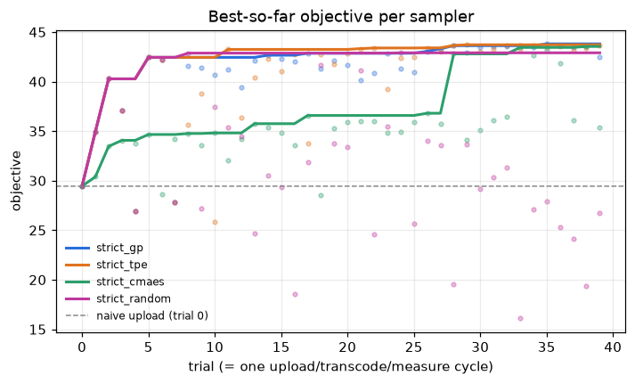
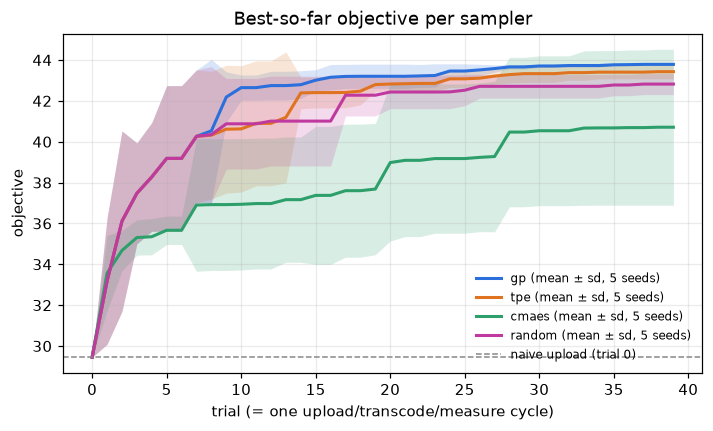
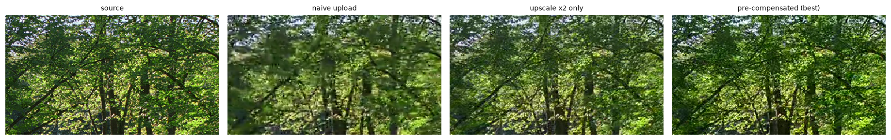
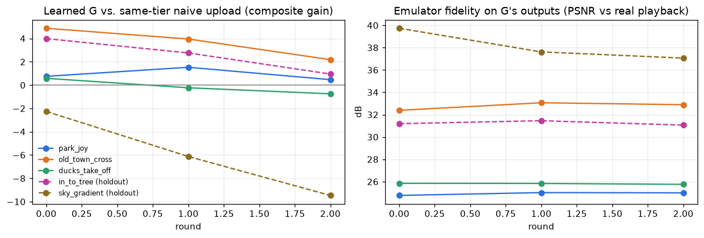
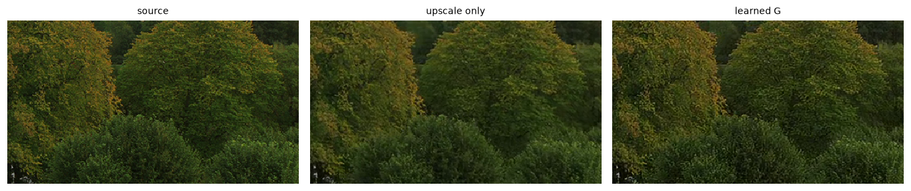

# video-regression: closed-loop black-box pre-compensation for platform video compression

Video platforms re-encode every upload with a policy you cannot see or differentiate through:
the codec, bit budget and ingest filtering depend on the upload's resolution, content and more.
"Upload the best possible master" is therefore **not** the same as "deliver the best possible
playback". This repo is a working demo of the idea in [`idea.md`](idea.md): treat the platform as
a black-box degradation channel `f_platform(·)` and optimise a pre-compensation `G(X; θ)` applied
*before* upload so that the playback `Y = f_platform(G(X; θ))` is as close as possible to the
original `X`.

```
 source X ──► G(X; θ) ──► upload ──► [ platform black box ] ──► playback Y ──► metric(Y, X)
                ▲                                                                  │
                └──────────── θ update (BO / TPE / CMA-ES, or learned G) ◄────────┘
```

Two optimisation routes are implemented, matching section 3 of the idea:

| Route | What is optimised | How | Code |
|---|---|---|---|
| **Black-box search** | 7 interpretable filter parameters (denoise, contrast, saturation, upload upscale / tier, unsharp amount + radius, temporal grain) | Optuna: GP Bayesian optimisation, multivariate TPE, CMA-ES, random baseline | `vreg optimize` |
| **Surrogate / emulator** | A per-pixel residual CNN `G` | Train a differentiable emulator `E ≈ f_platform` on real (upload, playback) pairs, back-prop through it, re-validate on the real black box, add the new pairs, repeat (domain adaptation) | `vreg surrogate` |

## Status and positioning

* **Status:** the full loop works end to end on **simulated** platforms. The real-platform
  adapter exists but has not been run yet. The `ugc_strict` sampler comparison uses five seeds
  and the learned `G` four; the other configurations use one seed.
  The checklist, what the results do and do not show, and the prioritised experiment backlog are
  in [`PROGRESS.md`](PROGRESS.md).
* **Not new:** learned pre-processing in front of a standard codec trained through a codec proxy
  (iSIZE DPP, ByteDance RPP), the "upload at 1440p/4K to get a better codec" tier trick (creator
  knowledge), and closed-loop channel matching against real platforms (robust steganography).
  These are cited, not claimed.
* **What this project adds:** optimisation from the **uploader's side** against an **unknown,
  adaptive** platform pipeline: ladder choice, ingest filtering, rate control and the served
  rendition. It runs in a closed loop with a small real-upload budget, and reports how much
  playback quality is recovered **beyond** the tier trick.
* **Current direction (after P0):** the filter gain beyond the tier trick was not confirmed for
  content in general. Only plain sharpening survives the independent judges. P1 therefore tests
  a **content-scoped** claim: for which **pre-registered content classes** does a learned `G`
  beat both the tier trick and class-tuned sharpening, with a content gate that switches
  filtering off elsewhere ([`docs/P1-plan.md`](docs/P1-plan.md)).

  The survey, the overlap check and the license notes for reusable code are in
  [`docs/related-work.md`](docs/related-work.md). The updated direction is in
  [`idea.md`](idea.md).

## Quick start

```bash
scripts/setup_env.sh          # uv + deps (CUDA torch) + static ffmpeg with libvmaf; no sudo needed
uv run vreg doctor            # check ffmpeg / libvmaf / encoders / GPU
uv run vreg clips all         # 3 synthetic clips + 4 Xiph clips (streams only the first 150 frames)

# black-box search: GP-BO on two clips, 40 trials
uv run vreg optimize --platform sim:ugc_strict --clips old_town_cross,park_joy --sampler gp --trials 40 --name strict_gp
uv run vreg transfer runs/strict_gp --clips all       # do the found params generalise?
uv run vreg report runs/strict_gp --out runs/report.html

# learned pre-compensation through a differentiable emulator
uv run vreg surrogate --clips park_joy,old_town_cross,ducks_take_off --holdout in_to_tree,sky_gradient --rounds 3 --name surrogate_trust
uv run vreg report runs/surrogate_trust --surrogate --out runs/surrogate.html

scripts/run_experiments.sh    # reproduces every result below (~4 h on a 6-core + RTX 4060 box)
uv run pytest -q              # fast unit tests on tiny clips (CI runs these without torch)
```

## Components

* **`vreg.platform`**: the black box. `SimulatedPlatform` reproduces behaviour real UGC platforms
  are known to have: the encode ladder (codec, CRF, maxrate cap) is selected by *upload*
  resolution, with ingest spatio-temporal denoising and capped-CRF rate control, and the viewer is
  served a fixed 720p rendition. Two hidden profiles are included:
  * `ugc_strict`: strong ingest denoising and tight caps; ≥1080p uploads get more bits, and ≥1440p
    uploads get HEVC.
  * `ugc_av1`: ≥1440p uploads get AV1.

  The optimiser only ever calls `process(upload) -> playback`.
  `CommandPlatform` is the adapter for a **real** platform: it takes your own upload command and
  download command (e.g. an upload CLI and `yt-dlp -f 'bv*[height=720]'`) and polls until the
  transcode is available. Use it only with your own account and content, within the platform's
  terms of service.
* **`vreg.precomp`**: `G(X; θ)` as an ffmpeg filter chain:
  `hqdn3d → eq → lanczos upscale → unsharp → temporal luma grain`. All parameters are continuous
  (discrete ones are snapped), so every sampler can use the same space.
* **`vreg.metrics`**: the score compares the playback, rescaled to the source resolution, with the
  source X. It uses:
  * **VMAF NEG** (the "no enhancement gain" model), because plain VMAF rewards over-sharpening,
    which is exactly the loophole an optimiser would find;
  * **LPIPS** (on the GPU);
  * **CAMBI** (Netflix's banding detector);
  * PSNR and SSIM for reference.

  The default objective is `composite = VMAF_NEG − 40·LPIPS − 2·CAMBI`.
* **`vreg.optimize`**: Optuna studies backed by SQLite, so they are resumable. Trial 0 is always
  the naive upload. Every (clip, θ) evaluation is cached on disk, so studies, transfers and
  reports reuse each other's work.
* **`vreg.surrogate`**: residual U-Net emulator `E` and generator `G`. The loop is: collect
  real pairs → fit `E` → train `G` with `LPIPS(E(G(X)), X) + L1` → validate on the real black box
  → add `G`'s real pairs → repeat. It logs the emulator's sim-to-real PSNR on `G`'s outputs, which
  is the number that tells you whether `G` is exploiting emulator errors.
* **`vreg.report`**: a self-contained HTML report with:
  * convergence curves per sampler;
  * a decomposition into naive, tier-only (upscale only) and full pre-compensation, so the gain
    from gaming the ladder is separated from the gain from filtering;
  * zoomed frame crops;
  * per-parameter sensitivity plots;
  * the transfer table.

## Results (simulated platforms, 3 s 720p clips, RTX 4060 + 6 cores)

Objective: `composite` (higher is better), averaged over the training clips `old_town_cross` and
`park_joy`. Each trial is one full render → transcode → measure cycle, about 15–40 s per clip.

### 1. Black-box search on `sim:ugc_strict`

| sampler | naive upload | best after 40 trials | gain | best found at trial |
|---|---|---|---|---|
| GP-BO | 29.45 | **43.80** | +14.35 | 35 |
| TPE | 29.45 | 43.71 | +14.26 | 29 |
| CMA-ES | 29.45 | 43.54 | +14.09 | 38 |
| random | 29.45 | 42.90 | +13.45 | 24 |



The table is the seed-0 run. Over five seeds (P0 E1, [P0 results](PROGRESS.md#6-p0-results)):

| sampler | final best, mean ± sd over 5 seeds |
|---|---|
| GP-BO | **43.79 ± 0.02** |
| TPE | 43.43 ± 0.35 |
| CMA-ES | 40.71 ± 3.82 |
| random | 42.82 ± 0.51 |



* **GP-BO beats TPE and random search**, using the rule that the mean difference must exceed
  both standard deviations. TPE beats random. GP-BO is also the most consistent sampler.
* **CMA-ES is unreliable at a 40-trial budget.** On two of five seeds it never left the ×1.5
  tier. With a population of 8, 40 trials are only five generations.
* **The objective is reproducible; the recipe is not.** Every GP-BO seed picks ×2 and +4–6 %
  contrast, and saturation is usually at its upper bound (+25 %). Grain (0–15) and unsharp
  amount (0.4–1.2) vary freely across seeds at the same score (43.77–43.80). The objective is
  flat along those knobs, so no particular grain or sharpening setting is "the" optimum. The
  saturation boost was earlier explained as counteracting the ingest denoiser's colour loss.
  The independent metrics below suggest it is mostly rewarded by the objective.

**Where does the gain come from?** The naive → tier-only → full decomposition (from `vreg transfer`):

| clip | naive | upscale ×2 only (tier trick) | best θ | filter gain over tier trick |
|---|---|---|---|---|
| old_town_cross *(train)* | 54.66 | 60.40 | 62.37 | +1.97 |
| park_joy *(train)* | 4.24 | 22.21 | 25.24 | +3.03 |
| ducks_take_off | 9.39 | 25.97 | 29.37 | +3.40 |
| in_to_tree | 49.49 | 58.28 | 61.99 | +3.71 |
| sky_gradient (synthetic) | 92.44 | 93.07 | 93.16 | +0.09 |
| mandelbrot (synthetic) | -18.98 | -10.22 | -9.38 | +0.84 |
| testsrc (synthetic graphics/text) | 68.26 | 69.43 | **57.87** | **−11.56** |

* **Most of the gain (~80 %) comes from gaming the encode ladder**: a bigger upload gets a better
  codec and more bits. This is the "resolution / tier deception" strategy from the idea. It is
  common creator knowledge (e.g. uploading 1440p to YouTube to get VP9/AV1), and in the
  simulator it holds by construction. Treat it as a sanity check that the optimiser finds the
  known trick, not as a finding. The interesting quantity is the gain **on top of** it.
* The **filtering** part adds a further +2–4 **on the objective** on natural footage, including
  unseen clips (ducks, in_to_tree). **Independent metrics do not confirm it**
  ([P0 results](PROGRESS.md#6-p0-results)). SSIMULACRA2 and XPSNR are *lower* than tier-only on
  every natural clip, and DISTS is flat. Most of the gain comes from the contrast and saturation
  boost plus grain, which VMAF NEG and LPIPS reward. With contrast and saturation frozen, the
  optimiser keeps 72 % of the composite gain with sharpening only (no grain), and that version
  passes two of three judges (DISTS, XPSNR).
* At the native tier (×1, no tier change) a filter-only search finds the same +3 composite gain
  from contrast alone, and **no** independent metric agrees. That is metric hacking.
* It **hurts synthetic graphics/text badly** (testsrc −11.6), because sharpening, grain and the
  colour boost damage flat colours and hard edges. Pre-compensation has to be **content-adaptive**.



### 2. Different black box, different optimum: `sim:ugc_av1`

GP-BO improves 38.03 → 41.67. The best θ is again ×2 upscale, which here gets AV1 instead of x264.
Unlike on `ugc_strict`, it uses **no grain** and **stronger sharpening** (1.29, 3×3). This
platform does no ingest denoising, so there is nothing for grain to survive. Its AV1 encode is
soft, so pre-emphasis pays off. Compensation is therefore platform-specific, which is the point of
closing the loop against the real target rather than tuning once.

The independent metrics agree with this gain on average, but one clip carries it. On park_joy the
AV1 tier-only upload is worse than naive on SSIMULACRA2, and θ recovers much of that loss. On the
other three natural clips, SSIMULACRA2 and XPSNR are slightly lower with θ than with tier-only.

### 3. Learned pre-compensation through a differentiable emulator (`vreg surrogate`)

`G` is a residual U-Net trained through a frozen emulator `E`, which is itself trained on real
(upload, playback) pairs from the black box. Training clips are park_joy, old_town_cross and
ducks_take_off; in_to_tree and sky_gradient are held out. The upload is fixed at ×2.

* **Without a trust region, `G` exploits the emulator.** Round 0 moved pixels by 18–32 levels on
  average. On those outputs the emulator's PSNR against the real playback fell to 19–25 dB, and
  real quality collapsed: old_town_cross went from 60.4 to 39.0, and park_joy and ducks also fell
  far below the upscale-only baseline (`runs/surrogate_naive`). This is the classic failure of
  optimising against a learned simulator.
* **With a trust region** (L1 penalty on `|G(X)−X|`, residual capped at 0.06), round 0 beats
  the same-tier naive upload on every natural clip in this run (seed 0), including the held-out
  one. Over three further seeds, it falls below tier-only on ducks_take_off (see below):

| clip | upscale only | learned G (round 0) | gain | GP-BO θ (for comparison) |
|---|---|---|---|---|
| old_town_cross | 60.40 | **65.28** | +4.88 | 62.37 |
| park_joy | 22.21 | 22.96 | +0.75 | 25.24 |
| ducks_take_off | 25.97 | 26.55 | +0.58 | 29.37 |
| in_to_tree *(held out)* | 58.28 | **62.26** | +3.98 | 61.99 |
| sky_gradient *(held out)* | 93.07 | 90.81 | −2.26 | 93.16 |




* Later "domain adaptation" rounds, which add `G`'s real pairs to `E`'s data and fine-tune both,
  **did not help in this run**:
  * `G`'s residual kept growing.
  * Gains shrank round over round.
  * The emulator's fidelity on `G`'s outputs barely moved (about 25 dB on park_joy and ducks).

  The report therefore selects the round by training-clip gain only, which was round 0. The run
  was stopped after round 2.
* In this run the learned `G` won on smoother, mid-detail content (old_town_cross, in_to_tree),
  and the 7-knob parametric θ won on very dense texture (park_joy, ducks), where the emulator is
  weakest (~25 dB). **Across seeds** (3 for `G`, 5 for θ; P0 E1), `G` beats θ only on
  old_town_cross (65.4 ± 0.9 vs 62.6 ± 0.2). They tie on in_to_tree. `G` is below tier-only on
  ducks_take_off in all three new seeds, and it damages the held-out gradient clip (−10 vs
  tier-only).
* Independent metrics partly agree with round 0. XPSNR is higher than tier-only on all four
  natural clips, and DISTS on three. **SSIMULACRA2 is lower on every clip** (mean −5.2), and
  VMAF NEG is lower on three of four, so most of `G`'s gain is in the LPIPS term.

### Caveats

* The platforms are **simulated**. The ladder rules are plausible but invented, so the specific
  numbers (especially the tier-trick gain) do not carry over to a real platform. The tooling does:
  point `CommandPlatform` at a real upload/download workflow.
* The clips are 3 seconds long. Apart from the `ugc_strict` samplers (5 seeds) and the learned
  `G` (4 seeds), each configuration has one seed.
* The objective is itself a model of quality. Grain and saturation gains are partly what LPIPS and
  VMAF-NEG reward. The found recipe (+contrast, +saturation, unsharp) is close to published VMAF
  and VMAF NEG attacks (Zvezdakova 2019; Siniukov 2021: VMAF NEG +23.6 % with no subjective
  gain). The P0 checks with SSIMULACRA2, DISTS and XPSNR did not confirm the `ugc_strict` filter
  gain (see above). Optimising any single metric, these included, lowered at least one of the
  others (the Goodhart matrix in [P0 results](PROGRESS.md#6-p0-results)). Without a viewer study,
  no filter gain here is established.

### What the results show so far

1. The closed loop works, and every sampler beats a naive upload. Over five seeds, GP-BO is the
   best and most consistent sampler, and CMA-ES sometimes misses the ×2 tier. The objective is
   reproducible, but the exact grain and sharpening values are not.
2. About 80 % of the gain is the known tier trick, and every independent metric confirms it.
   Filtering adds +2–4 *on the objective* on natural footage, but SSIMULACRA2 and XPSNR disagree,
   so this filter gain is **not confirmed**. A sharpening-only θ (contrast and saturation frozen)
   is the part that survives two of three judges. At the native tier, the filter gain is
   contrast hacking.
3. The same θ hurts graphics and text, so pre-compensation must be content-adaptive.
4. The optimum depends on the platform: grain on `ugc_strict`, none on `ugc_av1`. The `ugc_av1`
   filter gain passes the independent-metric check on average, but it rests on one clip.
5. A learned `G` exploits its emulator unless it is constrained. With a trust region it beats
   tier-only on the objective on most natural clips (not ducks_take_off across seeds), and on
   XPSNR and DISTS. SSIMULACRA2 is lower on every clip. It beats GP-BO θ only on
   old_town_cross. Domain-adaptation rounds did not help yet.

### Next steps

The full backlog is in [`PROGRESS.md`](PROGRESS.md#4-experiment-backlog). Each item lists what is
compared and what counts as success. In short:

* **P0, make the claims solid: done.** It covered:
  * several seeds;
  * independent metrics (SSIMULACRA2, DISTS, XPSNR);
  * an ablation with the contrast and saturation knobs frozen;
  * a Goodhart matrix (optimise one metric, judge with the others);
  * filter-only search at the native tier.

  The results and verdicts are in [`PROGRESS.md`](PROGRESS.md#6-p0-results).
* **P1 (current), content-scoped learned pre-compensation**
  ([`docs/P1-plan.md`](docs/P1-plan.md)):
  * a licensed set of about 60 clips;
  * pre-registered content classes from SI/TI, flat and dark fractions, and source type;
  * train/dev/confirm splits;
  * class-tuned sharpening-only θ as the baseline to beat;
  * global vs specialist `G` over 3 seeds;
  * a content gate;
  * one confirmation run on held-out clips.
* **P1-later, method improvements** (only if P1 shows `G` is worth improving):
  * a real-forward / surrogate-backward estimator for `G`;
  * an emulator ensemble or a conservative emulator;
  * a BO + `G` hybrid;
  * TuRBO and warm-started BO for a small real budget;
  * a common creator recipe as a baseline.
* **P1, simulator realism:**
  * passthrough below a bitrate cap;
  * AV1 film-grain synthesis;
  * several renditions;
  * cross-platform transfer.
* **P2, real platform and human study:**
  * a platform ladder probe;
  * a real closed loop on own content, with private uploads;
  * a small paired-comparison viewer study;
  * longer and more varied content.

## Repository layout

```
src/vreg/       ff.py content.py platform.py precomp.py metrics.py evaluate.py optimize.py report.py cli.py
src/vreg/surrogate/  models.py loop.py
scripts/        setup_env.sh run_experiments.sh run_p0.sh p0_tables.py
tests/          tiny-clip unit tests (run in GitHub Actions)
docs/img/       figures used in this README
docs/related-work.md  prior work, overlap check, reusable code and licenses
docs/P0-plan.md, docs/P1-plan.md  execution plans (P0 done, P1 current)
docs/paper/     LaTeX paper draft and bibliography (see docs/paper/README.md)
idea.md         project idea and direction (updated after the prior-work review)
PROGRESS.md     what is done, what the results show, experiment backlog
data/, runs/    generated clips and experiment outputs (git-ignored)
```
